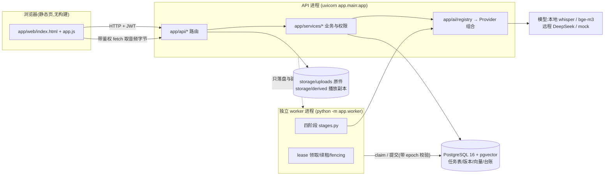
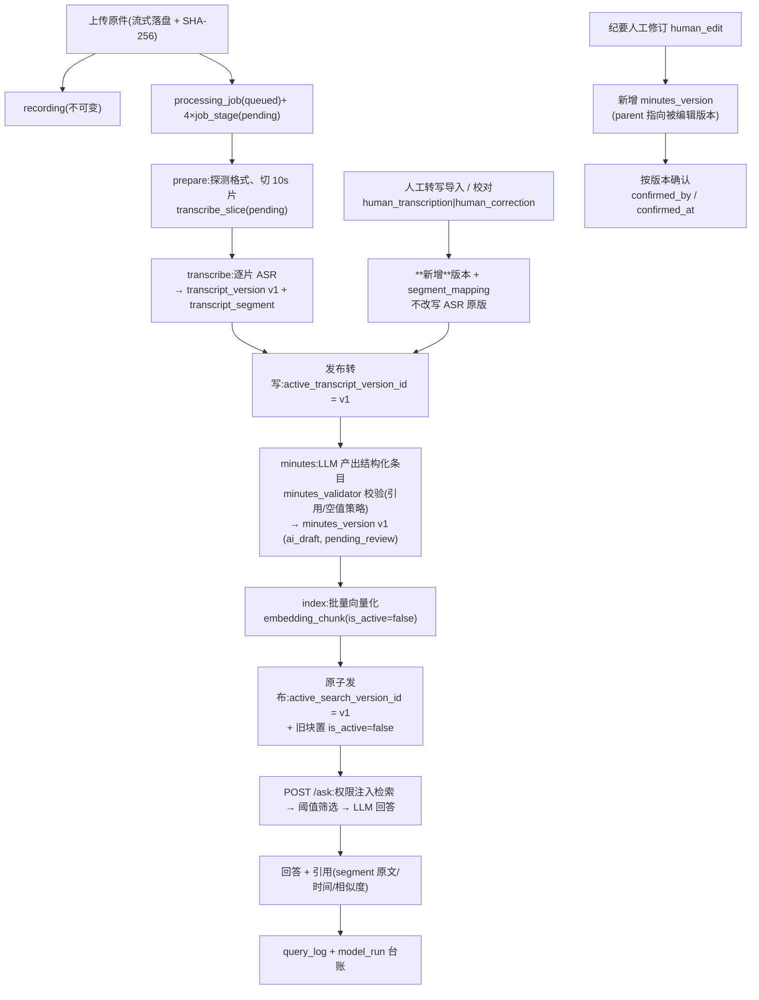
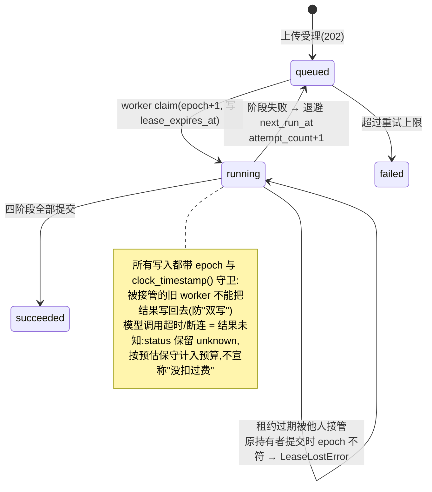
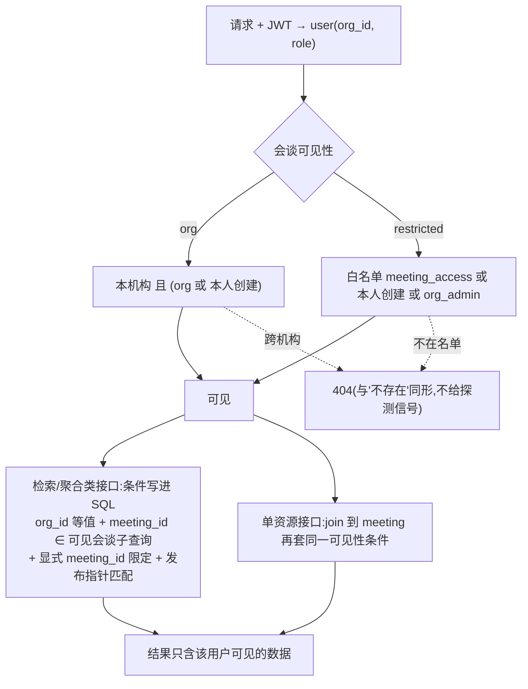

# 架构与流程图

配套文字说明见 `README.md`;权限逐接口清单见 `docs/PERMISSIONS.md`;
设计取舍与"为什么这样做"见 `docs/DECISIONS.md`。图中每个节点都能在代码里找到对应文件。

## 1. 进程与组件

要点:
- **API 与 worker 是两个进程**,只通过数据库里的任务表通信;上传请求内不调用任何模型。
- Provider 组合由仓库根 `.env` 决定,API / worker / 脚本读同一份;不可用时**报错而不静默回退 mock**。
- 音频文件不在任何静态挂载之下,只能经 `GET /recordings/{id}/audio` 取。

## 2. 数据流(一次会谈从上传到可问答)

要点:
- **双发布指针**:`active_transcript_version_id`(给人看的当前转写)与
  `active_search_version_id`(检索唯一依据)。索引未完成的版本哪怕误标 `is_active`
  也检索不到,因为指针不匹配。
- 版本与片段**只追加不覆盖**;校对、重转写、纪要编辑都是新版本 + 血缘字段。
- 每次外部模型调用一行 `model_run`(两阶段留痕:先插 unknown,再回写结果)。

## 3. 任务与租约状态机

## 4. 权限与可见性判定(每个读接口同一套)

不变量(有测试锁定):
- 机构归属**只由服务端从 JWT 解析**,界面不提供选机构入口;
- 冗余的 `is_active` / `org_id` 标志都不能单独作为授权依据,必须与指针和可见性子查询同时成立;
- 音频字节走同一可见性判定,`restricted` 同机构未授权也 404。
